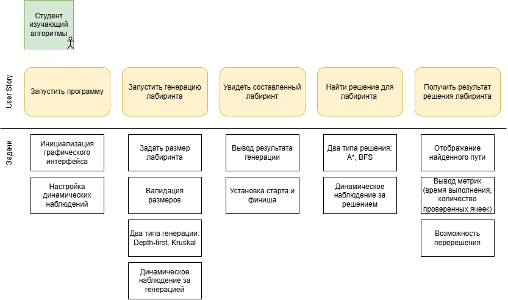
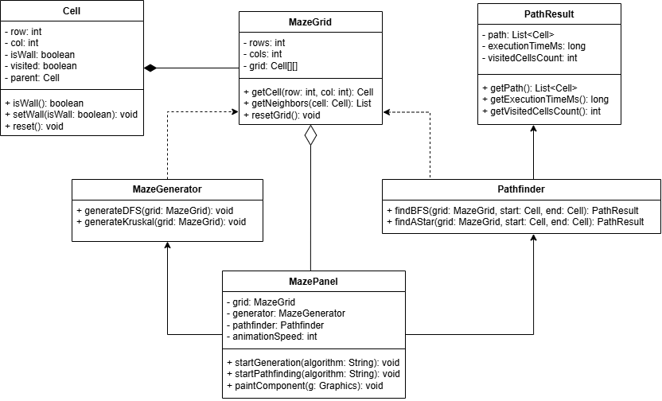
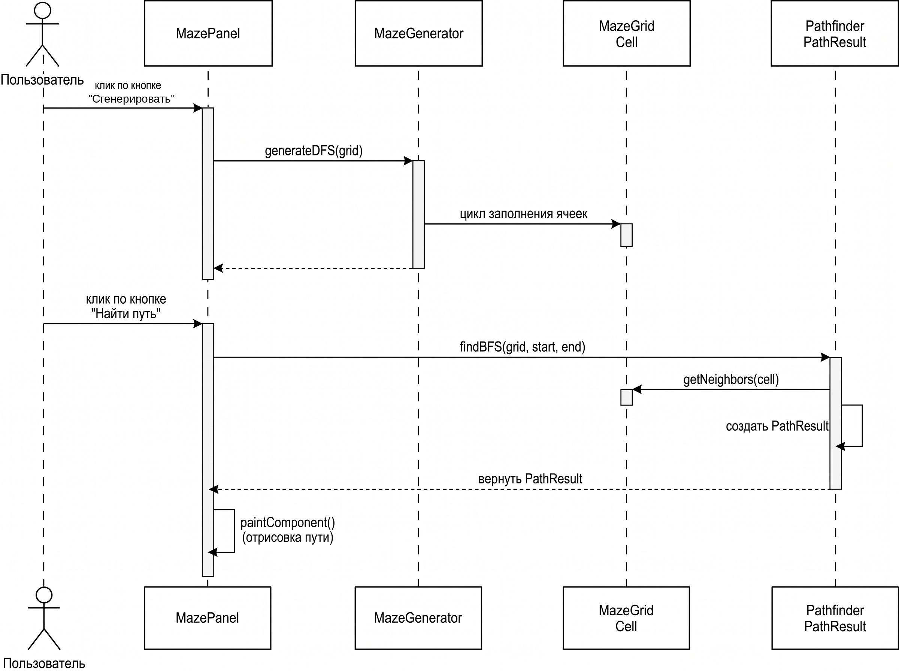
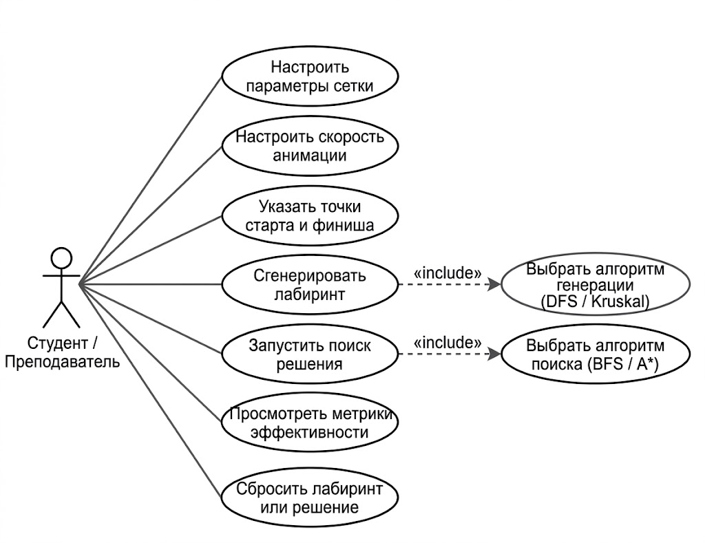

# Практическое занятие №2

**Выбор темы проекта. Сбор требований. Написание документации проекта. UML-диаграммы**

по дисциплине **«Проектирование и архитектура программного обеспечения»**

**Проект:** Генератор лабиринтов и поиск пути (вариант 20)

**Выполнил:** студент группы ЭПБО-02-25 Рыбаков Никита Викторович

**Преподаватель:** Яковлев Михаил Сергеевич

2026

> Исходный документ в формате Word: [PR2_Rybakov_EPBO-02-25.docx](PR2_Rybakov_EPBO-02-25.docx)

---

## Вопросы

**Генератор лабиринтов и поиск пути.** Суть: генерирует случайный лабиринт (Depth-first, Kruskal) и находит путь (A\*, BFS).

**1. Какие метрики успеха проекта? (например: скорость генерации, наглядность, количество поддерживаемых алгоритмов)**

Главное — наглядная визуализация: лабиринт не должен быть статичным, а ход работы алгоритмов должен быть хорошо виден.

**2. Опишите типичный сценарий работы пользователя от начала до конца.**

Пользователь запускает программу, выбирает алгоритм и в этом же окне читает его краткое описание. Затем он настраивает параметры визуализации и нажимает «Старт»: начинается отсчёт времени и сбор метрик, а лабиринт отображается в движении. Для перехода между экранами предусмотрены кнопки-стрелки (как «назад» на предыдущую страницу).

**3. Какие алгоритмы генерации обязательно нужны? (Depth-first, Kruskal, Prim, Recursive Division)**

Нужны четыре алгоритма из предложенного списка.

**4. Должен ли лабиринт быть идеальным (единственный путь между любыми двумя точками) или допускаются циклы?**

Допускается несколько путей, но программа должна строить единственный кратчайший. Если алгоритм не находит путь, нужно вывести сообщение «Данный алгоритм не может найти путь в этом лабиринте» и сгенерировать лабиринт заново.

**5. Нужна ли визуализация процесса генерации?**

Да, обязательно.

**6. Какие ограничения по размеру лабиринта? (например, до 1000×1000)**

Максимум 256×256; конкретный размер выбирает пользователь.

**7. Нужна ли возможность сравнения нескольких алгоритмов на одном лабиринте?**

Одновременное сравнение не требуется, но было бы большим плюсом иметь возможность запустить другой алгоритм на том же лабиринте.

**8. Какое максимальное время генерации и поиска допустимо для больших лабиринтов (например, 128×128 и 256×256)?**

Для 256×256 — не более 3 минут, для 128×128 — не более 1,5 минут, включая визуализацию.

**9. Алгоритмы нужно реализовать самостоятельно, без использования готовых библиотек.**

На основе проведённого сбора требований была построена диаграмма User Story Map, отражающая основные шаги пользователя и соответствующие им технические задачи.

*Рис. 1 — Диаграмма User Story Map*

---

## Введение

Цель проекта — создать на Java программу, которая визуализирует алгоритмы генерации лабиринтов и поиска пути. Приложение рассчитано на студентов и преподавателей: оно создаёт и решает лабиринты в реальном времени с настраиваемыми параметрами.

### Определения и аббревиатуры

- **Лабиринт** — генерируемая сетка заданного размера.
- **Решение** — путь между заданными стартом и финишем.
- **Depth-first (DFS)** — генерация через случайные коридоры до тупиков с возвратом к развилкам; даёт извилистые пути.
- **Kruskal** — генерация, которая объединяет случайные участки сетки, убирая стены, пока не получится единый лабиринт с множеством коротких развилок.
- **BFS (поиск в ширину)** — поиск пути волной по соседним клеткам; гарантированно находит кратчайший путь.
- **A\*** — поиск пути с эвристикой (близость к финишу), из-за чего проверяется меньше клеток, чем в BFS.
- **GUI** — графический интерфейс пользователя.

## Общее описание

Продукт — интерактивное учебное средство для наглядной визуализации алгоритмов на графах. Программа генерирует лабиринты произвольного размера (Depth-first, Kruskal), ищет кратчайший путь (A\*, BFS), показывает учебную информацию о выбранном алгоритме и выводит метрики (время работы, число проверенных ячеек). Пользователь задаёт размеры лабиринта, старт и финиш, параметры визуализации и алгоритм.

## Детальные требования

Требования собраны по гибкому подходу Agile с помощью User Story Mapping: он задал путь пользователя от запуска приложения до получения результатов (5 ключевых шагов с техническими задачами). Требования разделены на четыре категории.

### Бизнес-требования

- **БТ-1:** Создать наглядный и понятный инструмент для демонстрации алгоритмов на графах на практических занятиях.
- **БТ-2:** Дать возможность анализировать работу алгоритмов (время и число исследованных ячеек) и запускать разные алгоритмы поиска на одном лабиринте.

### Пользовательские требования

- **ПТ-1:** Как пользователь, я хочу задавать ширину и высоту лабиринта и выбирать алгоритм генерации, чтобы получать карты разной конфигурации.
- **ПТ-2:** Как пользователь, я хочу задавать старт и финиш, чтобы проверять алгоритмы поиска на разных расстояниях.
- **ПТ-3:** Как пользователь, я хочу видеть пошаговую анимацию алгоритмов, чтобы понимать их логику.
- **ПТ-4:** Как пользователь, я хочу получать метрики (время и число проверенных ячеек), чтобы сравнивать алгоритмы.
- **ПТ-5:** Как пользователь, я хочу сбросить найденный путь и запустить другой алгоритм на той же карте.
- **ПТ-6:** Как пользователь, я хочу видеть в том же окне краткое описание выбранного алгоритма и пользоваться кнопками навигации (стрелками «назад»).

### Функциональные требования

- **ФТ-1 (Интерфейс):** Система должна создавать окно с панелью настроек, холстом для сетки, блоком учебной информации и кнопками навигации.
- **ФТ-2 (Валидация):** Система должна проверять введённые размеры сетки (числовой формат, допустимый диапазон).
- **ФТ-3 (Генерация):** Система должна строить лабиринт выбранным алгоритмом (DFS или Kruskal).
- **ФТ-4 (Управление точками):** Система должна позволять задать старт и финиш вручную или случайно.
- **ФТ-5 (Поиск пути):** Система должна находить путь от старта к финишу выбранным алгоритмом (BFS или A\*).
- **ФТ-6 (Визуализация):** Система должна динамически показывать генерацию и поиск с регулировкой скорости.
- **ФТ-7 (Метрики):** По завершении поиска система должна выводить время выполнения (мс) и число исследованных ячеек.
- **ФТ-8 (Перерешение):** Система должна позволять очистить найденный путь без повторной генерации лабиринта.
- **ФТ-9 (Непроходимость):** Если путь не найден, система должна вывести сообщение «Данный алгоритм не может найти путь в этом лабиринте» и перегенерировать лабиринт.

### Нефункциональные требования

- **НФТ-1 (Стек технологий):** Java SE с использованием встроенной библиотеки Swing, без сторонних зависимостей.
- **НФТ-2 (Производительность):** Для плавной работы на больших сетках использовать PriorityQueue (бинарная куча) в A\*, ArrayDeque вместо рекурсии в DFS (во избежание переполнения стека), а шаги визуализации выполнять через таймер или отдельный поток, не блокируя отрисовку окна.
- **НФТ-3 (Надёжность):** Ошибки пользовательского ввода не должны приводить к аварийному завершению программы.
- **НФТ-4 (Удобство использования):** Размер ячеек должен автоматически масштабироваться под пропорции лабиринта, а объекты — чётко различаться по цвету.

---

## Диаграммы UML

*Рис. 2 — Диаграмма классов*

*Рис. 3 — Sequence Diagram (диаграмма последовательности)*

*Рис. 4 — Use Case Diagram (диаграмма вариантов использования)*
